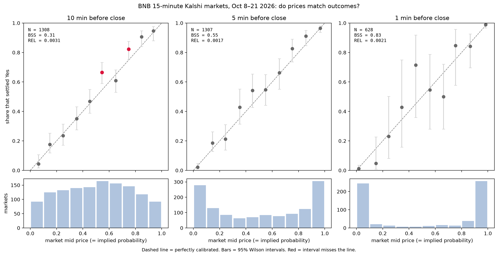

# Are Kalshi's 15-Minute Crypto Markets Calibrated?

Every 15 minutes, Kalshi runs a market asking whether BNB will finish the window at or above its starting price. A Yes contract pays $1, so its price is the market's implied probability. This project tests whether those probabilities hold up: do contracts priced at 30¢ win about 30% of the time, and 90¢ about 90%?

Take-home project for QMI at UT Austin (Fall 2026).

## Data

- **1,324 settled markets** (series `KXBNB15M`), Oct 8–21, 2026: 699 resolved Yes, 625 No
- **10.3M tick-level order-book updates** (best bid/ask), recorded live from Kalshi's feed
- The dataset was provided by QMI and is **not included** in this repo

## Method

1. **Snapshot without look-ahead bias:** for each market, take the last quote at or before 10, 5, and 1 minute before close using `pandas.merge_asof(direction="backward")`.
2. **Price:** mid = (bid + ask) / 2. Keep a snapshot only if both sides exist and the spread is ≤ 4¢.
3. **Group:** 10 equal-width price bins per horizon, with Wilson 95% intervals on each bin's Yes rate.
4. **Score:** Brier score, Brier skill score (vs. always guessing 50%), and the Murphy decomposition (reliability, resolution, uncertainty).
5. **Sensitivity:** rerun with a looser spread filter, 5 and 20 bins, and a deliberately wrong "nearest" join.

## Findings

| Horizon | Markets kept | Brier skill score | Reliability (REL) |
|---|---|---|---|
| 10 min | 1,308 | 0.31 | 0.0031 |
| 5 min | 1,307 | 0.55 | 0.0017 |
| 1 min | 628 | 0.83 | 0.0021 |

- BNB's markets are **well calibrated at all three moments**, and skill rises sharply as close approaches.
- At 10 minutes, two bins settled Yes more often than priced, but with about 30 intervals at 95%, one or two misses are expected by chance.
- **No favorite–longshot bias:** the cheapest and most expensive bins sit on the diagonal.
- **The spread filter matters most:** at 1 minute it drops 696 of 1,324 markets, and loosening it from 4¢ to 10¢ lowers skill from 0.83 to 0.77, because the strict filter removes the hardest-to-price markets.
- Bin count changes REL (0.0005 with 5 bins vs. 0.0036 with 20) but not the Brier skill score.

## Files

| File | Contents |
|---|---|
| `QMI_Kalshi_Starter.ipynb` | Full pipeline: loading, cleaning, snapshots, scoring, sensitivity checks, chart |
| `bins.csv` | Per-bin counts, mean price, Yes rate, and Wilson intervals for each horizon |
| `scores.csv` | Brier, REL, RES, UNC, and BSS for each horizon |
| `calibration_chart.png` | Calibration curves with intervals and bin counts |

## Tools

Python, pandas, NumPy, PyArrow, matplotlib, Jupyter
